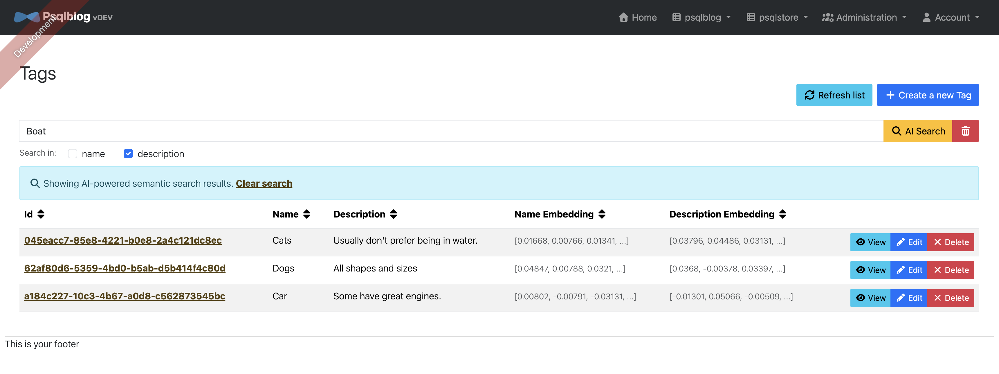

class: title

<div class="duo"><span class="p">PostgreSQL + pgvector</span><span class="c">ClickHouse</span></div>

# Vector Databases

<div class="subtitle">Faut-il vraiment une base de données dédiée pour la recherche sémantique ?</div>

<div class="authors">Marcus Sabon · Emilio Stien</div>
<div class="context">Polytech Grenoble — INFO5 — Veille technologique et stratégique — 2026</div>

???
[Emilio] ⏱ 0:30
Bonjour à tous. Nous allons vous parler des bases de données vectorielles, le composant qui se cache derrière la plupart des applications d'IA générative actuelles.
Notre fil rouge : faut-il une base spécialisée, ou une base que l'on connaît déjà suffit-elle ? On répondra avec deux démonstrations : PostgreSQL + pgvector, et ClickHouse.

---

<div class="kicker">Le problème</div>

## Retrouvez-moi « un robot qui tombe amoureux »

<div class="cols">
<div>
<h3>Recherche par mots-clés</h3>
<div class="result">SELECT titre FROM films<br>WHERE synopsis ILIKE '%robot%'<br>&nbsp;&nbsp;AND synopsis ILIKE '%amoureu%';<br><br><span class="zero">→ 0 ligne</span></div>
<p class="small muted">Le synopsis de WALL-E parle d'un « petit automate solitaire » dont une sonde « fait battre le cœur de métal ». Aucun mot en commun.</p>
</div>
<div>
<h3>Recherche par le sens</h3>
<div class="result">SELECT titre FROM films<br>ORDER BY embedding &lt;=&gt; :requete<br>LIMIT 3;<br><br><span class="hit">→ WALL-E, Her, …</span></div>
<p class="small muted">On ne compare plus des mots, on compare des <strong>vecteurs</strong> qui représentent le sens.</p>
</div>
</div>

???
[Emilio] ⏱ 1:30
Question à la salle : comment trouveriez-vous ce film avec une base classique ? LIKE ne marche pas : le synopsis ne contient ni "robot" ni "amoureux".
Le plein texte avec racinisation ne marche pas mieux. Il faut comparer le sens. C'est exactement ce que fait une base vectorielle.
⚠ Avant la séance : vérifier dans la démo que WALL-E et Her sortent bien en tête pour cette requête, et adapter la slide sinon.

---

<div class="kicker">Plan — 35 minutes</div>

## Ce que nous allons voir

<div class="steps">
<div><strong>Comprendre</strong> — embeddings, distances, index ANN (HNSW) <span class="tag">Emilio</span></div>
<div><strong>Marché et stratégie</strong> — acteurs, chronologie, consolidation <span class="tag">Marcus</span></div>
<div><strong>PostgreSQL + pgvector</strong> — le vecteur dans une base transactionnelle, cas JHipster, <em>démo 1</em> <span class="tag pg">Emilio</span></div>
<div><strong>ClickHouse</strong> — le vecteur dans une base analytique, <em>démo 2</em> <span class="tag ch">Marcus</span></div>
<div><strong>Face à face</strong> — benchmark équitable, comparaison, arbre de décision <span class="tag">Marcus &amp; Emilio</span></div>
<div><strong>Regard critique et recommandations</strong> <span class="tag">Marcus &amp; Emilio</span></div>
</div>

???
[Emilio] ⏱ 0:30
Six parties. Les deux démos sont au milieu, chacune juste après la présentation de sa technologie.

---

<div class="kicker">1 · Comprendre</div>

## Un embedding : le sens transformé en coordonnées

<div class="cols wide-right">
<div>
<p>Un <strong>modèle d'embedding</strong> (réseau de neurones) transforme un texte en un vecteur de <em>d</em> nombres.</p>
<div class="result">« un robot qui tombe amoureux »<br>→ [0.021, −0.087, 0.143, … ]<br><span class="muted">384 nombres (valeurs illustratives)</span></div>
<p class="small">Deux textes de sens proche → deux points proches, <strong>même sans mot commun</strong>, et même dans deux langues différentes.</p>
<p class="tiny">Notre démo : <code>paraphrase-multilingual-MiniLM-L12-v2</code> — 384 dimensions, ~50 langues, exécuté en local sur CPU.<br>Blueprint JHipster : OpenAI <code>text-embedding-3-small</code> — 1536 dimensions, API distante.</p>
</div>
<div>
<svg viewBox="0 0 600 400" role="img" aria-label="Projection 2D de films regroupés par genre">
<rect x="0" y="0" width="600" height="400" rx="16" fill="#f4f6fa"/>
<ellipse cx="180" cy="120" rx="130" ry="80" fill="#e5eef6"/>
<text x="70" y="62" font-size="15" font-weight="700" fill="#2f6690">Science-fiction / Animation</text>
<ellipse cx="460" cy="110" rx="105" ry="65" fill="#fde7e4"/>
<text x="395" y="62" font-size="15" font-weight="700" fill="#c0392b">Horreur</text>
<ellipse cx="170" cy="310" rx="120" ry="62" fill="#fff4c2"/>
<text x="70" y="262" font-size="15" font-weight="700" fill="#9a7400">Comédie</text>
<ellipse cx="450" cy="300" rx="115" ry="70" fill="#f6e6f2"/>
<text x="395" y="246" font-size="15" font-weight="700" fill="#8e2f72">Romance</text>
<g font-size="13" fill="#161a22">
<circle cx="120" cy="110" r="7" fill="#2f6690"/><text x="94" y="96">Matrix</text>
<circle cx="150" cy="150" r="7" fill="#2f6690"/><text x="98" y="172">Blade Runner</text>
<circle cx="230" cy="100" r="7" fill="#2f6690"/><text x="212" y="88">Interstellar</text>
<circle cx="265" cy="160" r="8" fill="#2f6690" stroke="#161a22" stroke-width="2"/><text x="236" y="186" font-weight="700">WALL-E</text>
<circle cx="335" cy="215" r="8" fill="#2f6690" stroke="#161a22" stroke-width="2"/><text x="350" y="219" font-weight="700">Her</text>
<circle cx="440" cy="100" r="7" fill="#c0392b"/><text x="418" y="88">Shining</text>
<circle cx="500" cy="135" r="7" fill="#c0392b"/><text x="470" y="158">Conjuring</text>
<circle cx="140" cy="300" r="7" fill="#9a7400"/><text x="96" y="325">Les Visiteurs</text>
<circle cx="210" cy="320" r="7" fill="#9a7400"/><text x="190" y="345">Intouchables</text>
<circle cx="430" cy="290" r="7" fill="#8e2f72"/><text x="402" y="315">Titanic</text>
<circle cx="490" cy="320" r="7" fill="#8e2f72"/><text x="470" y="345">La La Land</text>
</g>
<line x1="300" y1="182" x2="265" y2="160" stroke="#3949ab" stroke-width="2.5" stroke-dasharray="6 5"/>
<line x1="300" y1="182" x2="335" y2="215" stroke="#3949ab" stroke-width="2.5" stroke-dasharray="6 5"/>
<text x="300" y="191" font-size="30" text-anchor="middle" fill="#3949ab">★</text>
<text x="300" y="236" font-size="13" font-weight="700" text-anchor="middle" fill="#3949ab">requête</text>
</svg>
<p class="tiny center">Schéma : en réalité 384 dimensions, projetées en 2 D (onglet « Espace vectoriel » de la démo).</p>
</div>
</div>

???
[Emilio] ⏱ 2:00
Un embedding, c'est la sortie d'un réseau de neurones entraîné pour que des textes de sens proche donnent des vecteurs proches.
Les films se regroupent par genre alors que le modèle n'a jamais vu le genre : uniquement le titre et le synopsis.
La requête est vectorisée avec le même modèle : chercher, c'est trouver les points les plus proches de l'étoile.
Point important pour la suite : la base ne calcule pas les embeddings, c'est l'application qui le fait. La base stocke et cherche.

---

<div class="kicker">1 · Comprendre</div>

## Mesurer la proximité

| Distance | Intuition | pgvector | ClickHouse |
|---|---|---|---|
| **Cosinus** | angle entre les vecteurs (0 = même direction) | `a <=> b` | `cosineDistance(a, b)` |
| **Euclidienne (L2)** | distance « à vol d'oiseau » | `a <-> b` | `L2Distance(a, b)` |
| **Produit scalaire** | alignement × normes | `a <#> b` *(négatif)* | `dotProduct(a, b)` |
| **Manhattan (L1)** | somme des écarts | `a <+> b` | `L1Distance(a, b)` |

<div class="cols">
<div class="card soft"><h3>À retenir</h3><p>Avec des vecteurs <strong>normalisés</strong> (norme 1), cosinus, L2 et produit scalaire donnent <strong>le même classement</strong>. On choisit en général la distance pour laquelle le modèle a été entraîné : le cosinus.</p></div>
<div class="card soft"><h3>Une requête vectorielle</h3><p>Toujours la même forme, dans les deux bases :<br><code>ORDER BY distance(vecteur, requête) LIMIT k</code><br>c'est une recherche des <strong>k plus proches voisins</strong> (k-NN).</p></div>
</div>

???
[Emilio] ⏱ 1:30
Quatre distances, et la bonne nouvelle : les deux bases ont les mêmes, avec une syntaxe différente. PostgreSQL utilise des opérateurs, ClickHouse des fonctions.
Attention au piège de pgvector : <#> renvoie le produit scalaire NÉGATIF, pour que ORDER BY croissant marche.

---

<div class="kicker">1 · Comprendre</div>

## Le mur de la force brute

<div class="cols c3 center">
<div class="card soft"><div class="big accent">10 M</div><p class="small">documents</p></div>
<div class="card soft"><div class="big accent">× 1 536</div><p class="small">dimensions (float32)</p></div>
<div class="card soft"><div class="big bad">61 Go</div><p class="small">à lire et multiplier<br><strong>pour chaque requête</strong></p></div>
</div>

<div class="cols">
<div>
<h3>k-NN exact</h3>
<p class="small">Comparer la requête à <em>tous</em> les vecteurs : coût O(n · d). Résultat parfait, mais linéaire en n.</p>
</div>
<div>
<h3>ANN : <em>Approximate</em> Nearest Neighbors</h3>
<p class="small">Un index qui n'explore qu'une petite partie des vecteurs. On accepte de rater quelques vrais voisins pour aller <strong>100 à 1 000 fois</strong> plus vite.</p>
</div>
</div>

<p class="quote small">La métrique clé n'est pas seulement la latence, c'est le couple <strong>latence / recall</strong><br><span class="muted">recall@10 = part des 10 vrais plus proches voisins effectivement retrouvés.</span></p>

???
[Emilio] ⏱ 1:30
Calcul simple : 10 millions × 1536 × 4 octets = 61 Go par requête. Impossible en temps réel.
D'où les index approchés. Toute la suite va tourner autour d'un compromis : plus on explore, meilleur est le recall, plus c'est lent.
Retenez le mot recall, on le mesurera dans notre benchmark.

---

<div class="kicker">1 · Comprendre</div>

## HNSW : l'index qui a gagné

<div class="cols wide-right">
<div>
<p class="small"><strong>Hierarchical Navigable Small World</strong> (Malkov &amp; Yashunin, 2016) : un graphe de proximité à plusieurs étages, comme des autoroutes au-dessus des routes locales.</p>
<p class="small">On entre en haut, on saute vers le nœud le plus proche de la requête, on descend d'un étage, on recommence. En bas, on explore localement.</p>
<table>
<tr><th>Paramètre</th><th>Rôle</th><th>pgvector / ClickHouse</th></tr>
<tr><td><code>M</code></td><td>voisins par nœud</td><td>16 / 32</td></tr>
<tr><td><code>ef_construction</code></td><td>effort de construction</td><td>64 / 128</td></tr>
<tr><td><code>ef_search</code></td><td>effort de recherche</td><td>40 / 256</td></tr>
</table>
<p class="tiny">Valeurs par défaut. Notre benchmark aligne les deux bases sur M = 16, ef_construction = 64.</p>
</div>
<div>
<svg viewBox="0 0 640 400" role="img" aria-label="Graphe HNSW à trois couches">
<g font-size="13" fill="#5b6272">
<rect x="10" y="20" width="620" height="80" rx="14" fill="#f4f6fa"/><text x="22" y="40">Couche 2 — peu de nœuds, longs sauts</text>
<rect x="10" y="140" width="620" height="80" rx="14" fill="#f4f6fa"/><text x="22" y="160">Couche 1</text>
<rect x="10" y="260" width="620" height="120" rx="14" fill="#f4f6fa"/><text x="22" y="280">Couche 0 — tous les vecteurs</text>
</g>
<g stroke="#c5cbd8" stroke-width="2">
<line x1="80" y1="68" x2="330" y2="68"/><line x1="330" y1="68" x2="560" y2="68"/>
<line x1="80" y1="188" x2="190" y2="188"/><line x1="190" y1="188" x2="330" y2="188"/><line x1="330" y1="188" x2="450" y2="188"/><line x1="450" y1="188" x2="560" y2="188"/><line x1="190" y1="188" x2="450" y2="188" stroke-opacity="0"/>
<line x1="50" y1="330" x2="80" y2="300"/><line x1="80" y1="300" x2="130" y2="335"/><line x1="130" y1="335" x2="190" y2="305"/><line x1="190" y1="305" x2="240" y2="340"/><line x1="240" y1="340" x2="290" y2="310"/><line x1="290" y1="310" x2="330" y2="345"/><line x1="330" y1="345" x2="380" y2="305"/><line x1="380" y1="305" x2="420" y2="340"/><line x1="420" y1="340" x2="450" y2="305"/><line x1="450" y1="305" x2="500" y2="335"/><line x1="500" y1="335" x2="530" y2="300"/><line x1="530" y1="300" x2="560" y2="340"/><line x1="560" y1="340" x2="600" y2="310"/><line x1="380" y1="305" x2="450" y2="305"/><line x1="450" y1="305" x2="530" y2="300"/>
</g>
<g stroke="#3949ab" stroke-width="2" stroke-dasharray="5 5">
<line x1="560" y1="76" x2="560" y2="180"/><line x1="450" y1="196" x2="450" y2="297"/>
</g>
<g stroke="#3949ab" stroke-width="4" fill="none">
<path d="M80 68 L330 68 L560 68"/><path d="M560 188 L450 188"/>
</g>
<g fill="#8a93a6">
<circle cx="80" cy="68" r="9" fill="#3949ab"/><circle cx="330" cy="68" r="9" fill="#3949ab"/><circle cx="560" cy="68" r="9" fill="#3949ab"/>
<circle cx="80" cy="188" r="8"/><circle cx="190" cy="188" r="8"/><circle cx="330" cy="188" r="8"/><circle cx="450" cy="188" r="9" fill="#3949ab"/><circle cx="560" cy="188" r="9" fill="#3949ab"/>
<circle cx="50" cy="330" r="7"/><circle cx="80" cy="300" r="7"/><circle cx="130" cy="335" r="7"/><circle cx="190" cy="305" r="7"/><circle cx="240" cy="340" r="7"/><circle cx="290" cy="310" r="7"/><circle cx="330" cy="345" r="7"/><circle cx="380" cy="305" r="7"/><circle cx="420" cy="340" r="7"/><circle cx="530" cy="300" r="7"/><circle cx="560" cy="340" r="7"/><circle cx="600" cy="310" r="7"/>
<circle cx="450" cy="305" r="9" fill="#1f8a55"/><circle cx="500" cy="335" r="9" fill="#1f8a55"/>
</g>
<text x="80" y="58" font-size="12" text-anchor="middle" fill="#3949ab" font-weight="700">entrée</text>
<text x="474" y="330" font-size="26" text-anchor="middle" fill="#3949ab">★</text>
<text x="474" y="370" font-size="13" text-anchor="middle" fill="#1f8a55" font-weight="700">plus proches voisins</text>
</svg>
</div>
</div>

???
[Emilio] ⏱ 2:00
HNSW est aujourd'hui l'index par défaut partout : pgvector, ClickHouse, Qdrant, Elasticsearch, etc.
L'intuition : la couche du haut contient peu de points reliés par de longs sauts ; on s'approche grossièrement de la cible puis on affine en descendant.
Coût : le graphe doit tenir en mémoire, et sa construction est coûteuse. C'est un point qu'on retrouvera dans les limites des deux bases.

---

<div class="kicker">1 · Comprendre</div>

## Les autres leviers : partitionner, compresser

<div class="cols c3">
<div class="card soft"><h3>IVF (inverted file)</h3><p>On découpe l'espace en <em>listes</em> par k-means, on ne fouille que les plus proches (<code>probes</code>).</p><p class="small muted">pgvector : <code>ivfflat</code>. Construction rapide, recall plus sensible aux données.</p></div>
<div class="card soft"><h3>Quantification</h3><p>Stocker chaque dimension sur moins de bits : float32 → bf16 (×2), int8 (×4), binaire (×32).</p><p class="small muted">pgvector : <code>halfvec</code>, <code>bit</code>. ClickHouse : <code>bf16</code> par défaut, <code>i8</code>, <code>b1</code> + rescoring.</p></div>
<div class="card soft"><h3>Sur disque</h3><p>Graphes conçus pour SSD (DiskANN) ou stockage objet, quand la RAM ne suffit plus.</p><p class="small muted">pgvectorscale (Timescale), Amazon S3 Vectors.</p></div>
</div>

<p class="small">Toutes ces techniques déplacent le même curseur : <strong>mémoire ↔ vitesse ↔ recall</strong>.</p>

???
[Emilio] ⏱ 1:00 (diapo compressible si on est en retard)
Deux autres familles : partitionner l'espace, ou compresser les vecteurs. La quantification est devenue essentielle : ClickHouse stocke son graphe en bfloat16 par défaut, soit deux fois moins de mémoire.

---

<div class="kicker">1 · Comprendre</div>

## Pourquoi tout le monde en parle : le RAG

<svg viewBox="0 0 1000 250" role="img" aria-label="Chaîne RAG">
<defs><marker id="ar" viewBox="0 0 10 10" refX="9" refY="5" markerWidth="7" markerHeight="7" orient="auto"><path d="M0 0 L10 5 L0 10 z" fill="#5b6272"/></marker></defs>
<g font-size="17" text-anchor="middle">
<rect x="10" y="20" width="160" height="70" rx="12" fill="#f4f6fa"/><text x="90" y="52">Documents</text><text x="90" y="74" font-size="13" fill="#5b6272">PDF, wiki, tickets…</text>
<rect x="215" y="20" width="160" height="70" rx="12" fill="#f4f6fa"/><text x="295" y="52">Découpage</text><text x="295" y="74" font-size="13" fill="#5b6272">chunks</text>
<rect x="420" y="20" width="160" height="70" rx="12" fill="#e8eafb"/><text x="500" y="52">Embeddings</text><text x="500" y="74" font-size="13" fill="#5b6272">modèle</text>
<rect x="625" y="20" width="200" height="200" rx="14" fill="#e8eafb" stroke="#3949ab" stroke-width="2"/><text x="725" y="110" font-weight="700" fill="#3949ab">Base vectorielle</text><text x="725" y="136" font-size="14" fill="#5b6272">stocke + top-k</text>
<rect x="10" y="150" width="160" height="70" rx="12" fill="#f4f6fa"/><text x="90" y="182">Question</text><text x="90" y="204" font-size="13" fill="#5b6272">utilisateur</text>
<rect x="420" y="150" width="160" height="70" rx="12" fill="#e8eafb"/><text x="500" y="182">Embedding</text><text x="500" y="204" font-size="13" fill="#5b6272">même modèle</text>
<rect x="860" y="80" width="130" height="80" rx="12" fill="#e9f6ef"/><text x="925" y="114">LLM</text><text x="925" y="138" font-size="13" fill="#5b6272">réponse sourcée</text>
</g>
<g stroke="#5b6272" stroke-width="2" marker-end="url(#ar)">
<line x1="170" y1="55" x2="212" y2="55"/><line x1="375" y1="55" x2="417" y2="55"/><line x1="580" y1="55" x2="622" y2="55"/>
<line x1="170" y1="185" x2="417" y2="185"/><line x1="580" y1="185" x2="622" y2="185"/><line x1="825" y1="120" x2="857" y2="120"/>
</g>
</svg>

<div class="cols c4 small">
<div><span class="tag accent">RAG</span><br>chatbot sur documentation interne</div>
<div><span class="tag accent">Recommandation</span><br>« si vous avez aimé… »</div>
<div><span class="tag accent">Dédoublonnage</span><br>tickets, fiches produits</div>
<div><span class="tag accent">Multimodal</span><br>image ↔ texte, audio</div>
</div>

???
[Emilio] ⏱ 1:00
Le cas d'usage qui a tout déclenché en 2023 : le RAG. On donne au LLM les passages pertinents de vos documents, retrouvés par recherche vectorielle.
La base vectorielle est la mémoire à long terme de l'application. Je passe la parole à Marcus pour le marché.

---

<div class="kicker">2 · Marché et stratégie</div>

## Trois familles d'acteurs

<div class="cols c3">
<div class="card accent"><h3>Bases dédiées</h3>
<p><span class="tag">Pinecone</span><span class="tag">Qdrant</span><span class="tag">Weaviate</span><span class="tag">Milvus / Zilliz</span><span class="tag">Chroma</span></p>
<p class="small">Conçues pour le vecteur : échelle, filtres, multi-tenant, serverless. Une brique de plus à opérer.</p></div>
<div class="card soft"><h3>Bases existantes + vecteur</h3>
<p><span class="tag pg">PostgreSQL / pgvector</span><span class="tag ch">ClickHouse</span><span class="tag">Elasticsearch</span><span class="tag">OpenSearch</span><span class="tag">MongoDB Atlas</span><span class="tag">Redis</span><span class="tag">Oracle 23ai</span><span class="tag">SQL Server 2025</span><span class="tag">DuckDB</span></p>
<p class="small">Le vecteur devient une colonne de plus, à côté des données métier.</p></div>
<div class="card soft"><h3>Stockage objet</h3>
<p><span class="tag">Amazon S3 Vectors</span></p>
<p class="small">GA en décembre 2025 : jusqu'à 2 milliards de vecteurs par index, ~100 ms pour les requêtes fréquentes, facturation à l'usage.</p></div>
</div>

<p class="small"><strong>Notre sujet</strong> : deux représentants de la 2<sup>e</sup> famille, aux philosophies opposées — une base <span class="tag pg">transactionnelle</span> et une base <span class="tag ch">analytique</span>.</p>

???
[Marcus] ⏱ 1:30
Le marché se structure en trois familles. Les pure players, nés entre 2019 et 2022. Les bases généralistes, qui ont toutes ajouté un type vecteur. Et depuis fin 2025, le stockage objet avec S3 Vectors, qui attaque par le coût.
Nous comparons deux représentants de la famille du milieu, choisis parce qu'ils sont à l'opposé : OLTP contre OLAP.

---

<div class="kicker">2 · Marché et stratégie</div>

## Chronologie : de la ruée à la consolidation

<div class="timeline">
<div class="row"><b>2016</b><span>Publication de HNSW (Malkov &amp; Yashunin)</span></div>
<div class="row"><b>2019</b><span>Création de Pinecone ; Milvus publié en open source</span></div>
<div class="row pg"><b>2021</b><span>Première version de <strong>pgvector</strong> (Andrew Kane)</span></div>
<div class="row"><b>2023</b><span>Effet ChatGPT : Pinecone lève 100 M$ (valorisation 750 M$). <strong>pgvector 0.5 ajoute HNSW</strong></span></div>
<div class="row pg"><b>2024</b><span>pgvector 0.7 : <code>halfvec</code>, <code>sparsevec</code>, quantification binaire — 0.8 : <em>iterative index scans</em> (filtres)</span></div>
<div class="row"><b>mai 2025</b><span>Databricks rachète Neon (Postgres serverless) pour ~1 Md$</span></div>
<div class="row ch"><b>août 2025</b><span><strong>ClickHouse 25.8</strong> : index <code>vector_similarity</code> (HNSW) utilisable en production</span></div>
<div class="row"><b>déc. 2025</b><span>Amazon S3 Vectors en disponibilité générale</span></div>
<div class="row ch"><b>janv. 2026</b><span>ClickHouse lève 400 M$ (valorisation 15 Md$) et rachète Langfuse (observabilité LLM)</span></div>
<div class="row"><b>2026</b><span>Qdrant : série B de 50 M$ (mars, presse spécialisée). Pinecone aurait exploré une vente (presse, 2025)</span></div>
<div class="row pg"><b>oct. 2026</b><span>pgvector 0.8.7 ; 0.9 en préparation (I/O asynchrones pour HNSW)</span></div>
</div>

???
[Marcus] ⏱ 2:00
2023, c'est la ruée : tout le monde lève des fonds. Mais dès 2023, pgvector ajoute HNSW et rattrape l'essentiel du besoin.
2025-2026, c'est la consolidation : les acteurs de la donnée rachètent du Postgres (Databricks/Neon), ClickHouse se positionne sur l'IA avec Langfuse, AWS sort S3 Vectors.
Les chiffres de levée viennent de la presse ; ceux de Qdrant et Pinecone sont à prendre comme des signaux, pas comme des faits audités.

---

<div class="kicker">2 · Marché et stratégie</div>

## Notre thèse : le vecteur devient un <em>type</em>, plus un produit

<div class="cols">
<div class="card pg"><h3>Ce qui la soutient</h3>
<ul>
<li>Chaque grande base a ajouté le vecteur entre 2023 et 2025</li>
<li>Pas de synchronisation entre deux systèmes : une seule source de vérité, un seul backup, un seul contrôle d'accès</li>
<li>Les clouds le proposent déjà en service managé (RDS, Cloud SQL, Azure, Supabase, Neon…)</li>
<li>Pression sur les prix : AWS annonce jusqu'à −90 % avec S3 Vectors</li>
</ul></div>
<div class="card ch"><h3>Ce qui la nuance</h3>
<ul>
<li>À des milliards de vecteurs et forte charge, les bases dédiées gardent une avance (sharding, filtres, multi-tenant)</li>
<li>Les dédiées se repositionnent : recherche hybride, serverless, agents</li>
<li>Une base généraliste partage CPU et RAM avec le reste de l'application</li>
</ul></div>
</div>

<p class="quote small">La question n'est plus « quelle base vectorielle ? » mais « <strong>ma base actuelle suffit-elle ?</strong> »</p>

???
[Marcus] ⏱ 1:30
C'est la partie stratégique. Notre lecture : le vecteur suit le chemin du JSON il y a dix ans. Au début, il fallait MongoDB ; aujourd'hui, PostgreSQL a jsonb et c'est suffisant dans la majorité des cas.
Mais restons critiques : à très grande échelle, une base dédiée reste pertinente. On y reviendra avec l'arbre de décision.

---

<div class="kicker">2 · Marché et stratégie</div>

## Carte de positionnement

<svg viewBox="0 0 1000 470" role="img" aria-label="Carte de positionnement des solutions vectorielles">
<rect x="90" y="20" width="880" height="390" rx="16" fill="#f4f6fa"/>
<g stroke="#8a93a6" stroke-width="2"><line x1="90" y1="410" x2="970" y2="410"/><line x1="90" y1="410" x2="90" y2="20"/></g>
<text x="530" y="450" font-size="17" text-anchor="middle" fill="#5b6272">Transactionnel (OLTP, mises à jour, ACID)  ⟶  Analytique (OLAP, gros volumes, agrégats)</text>
<text x="40" y="215" font-size="17" text-anchor="middle" fill="#5b6272" transform="rotate(-90 40 215)">Millions  ⟶  Milliards de vecteurs</text>
<g font-size="17" text-anchor="middle">
<ellipse cx="250" cy="320" rx="150" ry="62" fill="#e5eef6" stroke="#2f6690" stroke-width="3"/><text x="250" y="315" font-weight="700" fill="#2f6690">PostgreSQL + pgvector</text><text x="250" y="340" font-size="14" fill="#5b6272">jointures, ACID, &lt; dizaines de M</text>
<ellipse cx="800" cy="170" rx="150" ry="62" fill="#fff4c2" stroke="#9a7400" stroke-width="3"/><text x="800" y="165" font-weight="700" fill="#9a7400">ClickHouse</text><text x="800" y="190" font-size="14" fill="#5b6272">vecteur + agrégats, append-only</text>
<ellipse cx="510" cy="110" rx="150" ry="55" fill="#e8eafb"/><text x="510" y="105" font-weight="700" fill="#3949ab">Bases dédiées</text><text x="510" y="129" font-size="14" fill="#5b6272">Pinecone, Qdrant, Milvus, Weaviate</text>
<ellipse cx="790" cy="60" rx="110" ry="32" fill="#ffffff" stroke="#8a93a6" stroke-dasharray="6 5"/><text x="790" y="66" fill="#5b6272">S3 Vectors (archive)</text>
<ellipse cx="520" cy="270" rx="135" ry="48" fill="#ffffff" stroke="#8a93a6"/><text x="520" y="266" fill="#161a22">Elasticsearch / OpenSearch</text><text x="520" y="289" font-size="14" fill="#5b6272">plein texte + vecteur</text>
<ellipse cx="270" cy="185" rx="140" ry="44" fill="#ffffff" stroke="#8a93a6"/><text x="270" y="181" fill="#161a22">MongoDB, Oracle, SQL Server</text><text x="270" y="203" font-size="14" fill="#5b6272">le vecteur chez l'existant</text>
</g>
</svg>
<p class="tiny">Lecture qualitative issue de notre analyse, pas d'une mesure.</p>

???
[Marcus] ⏱ 1:00
Sur cette carte, nos deux candidats sont aux coins opposés. pgvector : là où vivent déjà vos données métier, avec transactions et jointures. ClickHouse : là où vivent les logs, les événements, les gros volumes.
Après la démo, on verra si cette intuition se vérifie. Emilio, pgvector.

---

<div class="kicker pg">3 · PostgreSQL + pgvector</div>

## pgvector en bref

<div class="cols wide-left">
<div>
<ul class="small">
<li><strong>Extension C</strong> pour PostgreSQL 13+ (14+ à partir de 0.9), licence PostgreSQL — open source</li>
<li>Créée par Andrew Kane en 2021 ; version 0.8.7 (octobre 2026)</li>
<li><strong>Types</strong> : <code>vector</code> (jusqu'à 16 000 dim.), <code>halfvec</code>, <code>bit</code>, <code>sparsevec</code></li>
<li><strong>Index</strong> : HNSW et IVFFlat — indexables jusqu'à <strong>2 000 dim.</strong> en <code>vector</code>, 4 000 en <code>halfvec</code></li>
<li><strong>Distances</strong> : <code>&lt;-&gt;</code> L2, <code>&lt;=&gt;</code> cosinus, <code>&lt;#&gt;</code> produit scalaire, <code>&lt;+&gt;</code> L1, Hamming, Jaccard</li>
<li>0.8 : <em>iterative index scans</em> — l'index continue s'il manque des résultats après un <code>WHERE</code></li>
</ul>
</div>
<div class="card pg">
<h3>Disponible partout</h3>
<p><span class="tag pg">AWS RDS / Aurora</span><span class="tag pg">Google Cloud SQL</span><span class="tag pg">AlloyDB</span><span class="tag pg">Azure PostgreSQL</span><span class="tag pg">Supabase</span><span class="tag pg">Neon</span></p>
<p class="small">L'argument décisif : <strong>aucune nouvelle infrastructure</strong>. Si vous avez PostgreSQL, vous avez déjà une base vectorielle.</p>
</div>
</div>

???
[Emilio] ⏱ 1:30
pgvector est une simple extension : CREATE EXTENSION vector, et c'est tout.
Retenez la limite des 2000 dimensions indexables : elle aura une conséquence sur le blueprint JHipster dans deux diapos.

---

<div class="kicker pg">3 · PostgreSQL + pgvector</div>

## Le vecteur, une colonne comme les autres

```sql
CREATE EXTENSION vector;

CREATE TABLE films (
    id        int PRIMARY KEY,
    titre     text,
    annee     int,
    pays      text,
    synopsis  text,
    embedding vector(384)                       -- le type apporté par pgvector
);

CREATE INDEX ON films USING hnsw (embedding vector_cosine_ops)
    WITH (m = 16, ef_construction = 64);

-- Recherche hybride : filtre SQL classique + similarité, dans une seule requête
SELECT titre, annee, embedding <=> $1 AS distance
FROM films
WHERE annee >= 2000 AND pays = 'France'
ORDER BY embedding <=> $1
LIMIT 5;
```

???
[Emilio] ⏱ 1:00
Tout est du SQL standard. Le vecteur vit dans la même ligne que le titre : pas de synchronisation, et un INSERT est atomique.
Le $1, c'est le vecteur de la requête, calculé par l'application.

---

<div class="kicker pg">3 · PostgreSQL + pgvector — cas industriel</div>

## Le blueprint JHipster <code>generator-jhipster-ai-postgresql</code>

<div class="cols wide-right">
<div class="small">
<p>Blueprint open source (Saathratri, licence MIT) pour JHipster 9 : on <strong>annote</strong> un champ dans le modèle JDL…</p>
<pre><code class="language-text">entity Tag {
  name String required
  @customAnnotation("VECTOR")
  @customAnnotation("1536")
  nameEmbedding Blob
}</code></pre>
<p>… et il génère tout : colonne <code>vector(1536)</code> et index HNSW (Liquibase), Spring AI + OpenAI <code>text-embedding-3-small</code>, embedding recalculé à chaque création / modification, migration au démarrage, barre « AI Search » en Angular, tests d'intégration.</p>
</div>
<div>

<p class="tiny">Capture du dépôt du blueprint : la recherche « Boat » sur les descriptions remonte « Cats — <em>Usually don't prefer being in water</em> ».</p>
</div>
</div>

???
[Emilio] ⏱ 1:30
C'est le dépôt qui nous a été fourni. Il montre ce qu'est pgvector en contexte industriel : on ne l'utilise pas à la main, on l'intègre dans une chaîne de génération de code.
Regardez la capture : "Boat" trouve "Cats" via la notion d'eau. C'est à la fois la force et la faiblesse de la recherche sémantique : c'est lié, mais est-ce pertinent ?

---

<div class="kicker pg">3 · PostgreSQL + pgvector — cas industriel</div>

## Regard critique sur le blueprint

<div class="cols">
<div class="card pg"><h3>Points forts</h3>
<ul>
<li>Industrialisation : schéma, index, API, UI et tests générés</li>
<li>Index HNSW cosinus créé automatiquement</li>
<li>Rattrapage des embeddings manquants au démarrage</li>
<li>Mode « fake » déterministe : tests sans clé ni réseau</li>
</ul></div>
<div class="card soft"><h3>Points de vigilance</h3>
<ul>
<li>Appel HTTP à OpenAI <strong>dans la transaction</strong> du <code>save()</code> : latence, coût, panne externe sur le chemin d'écriture</li>
<li>Données envoyées à un tiers hors UE → question <strong>RGPD</strong> et souveraineté</li>
<li>Seuil de distance <strong>0,8 codé en dur</strong>, non calibré (d'où « Boat » → « Cats »)</li>
<li><code>text-embedding-3-large</code> (3 072 dim.) dépasserait les 2 000 dim. indexables → <code>halfvec</code> obligatoire</li>
<li>Changer de modèle = revectoriser toute la base ; pas de recherche hybride plein texte + vecteur</li>
</ul></div>
</div>

???
[Emilio] ⏱ 1:30
Notre regard d'ingénieur : c'est un excellent accélérateur, mais certains choix ne passeraient pas en production chez nous.
Le plus important : l'appel réseau vers OpenAI dans la transaction. Une solution classique : écrire la ligne, puis calculer l'embedding de façon asynchrone (file de messages, outbox).
Et le seuil fixe : il faudrait le calibrer sur un jeu de requêtes annotées.

---

class: demo

<div class="kicker pg">Démo 1 · 6 min</div>

# PostgreSQL + pgvector

<div class="steps demo-steps pg">
<div><strong>Interface</strong> — « un robot qui tombe amoureux » : plein texte (0 ou mauvais résultats) vs pgvector</div>
<div><strong>Multilingue</strong> — « a heist movie with a clever crew » retrouve Ocean's Eleven et Heat</div>
<div><strong>Hybride</strong> — mêmes requêtes, filtrées par pays et par année : du SQL normal</div>
<div><strong>psql</strong> — <code>INSERT</code> d'un film dans une transaction, visible immédiatement, puis <code>ROLLBACK</code></div>
<div><strong>Preuve</strong> — <code>EXPLAIN ANALYZE</code> : <em>Index Scan using films_embedding_hnsw</em></div>
</div>

<p class="url">http://localhost:8000 · demo/sql/1_postgres_pgvector.sql</p>

???
[Emilio] ⏱ 6:00 — voir DEROULE-DEMO.md, section Démo 1.
Plan B : vidéo pré-enregistrée demo1.mp4.

---

<div class="kicker ch">4 · ClickHouse</div>

## ClickHouse en bref

<div class="cols wide-left">
<div>
<ul class="small">
<li><strong>SGBD analytique en colonnes</strong>, open source (Apache 2.0) ; né chez Yandex, ouvert en 2016, société ClickHouse Inc. depuis 2021</li>
<li>Pas de type dédié : un vecteur est un <code>Array(Float32)</code> (ou <code>BFloat16</code>, <code>Float64</code>)</li>
<li>Fonctions <code>cosineDistance</code>, <code>L2Distance</code>, <code>dotProduct</code>… exécutées en <strong>SIMD</strong> sur des colonnes compressées : la force brute est déjà très rapide</li>
<li>Index <code>vector_similarity</code> : <strong>HNSW</strong> (bibliothèque USearch), disponible à partir de la 25.8</li>
<li>Graphe quantifié en <code>bf16</code> par défaut (aussi <code>i8</code>, <code>b1</code>) avec <em>rescoring</em> en pleine précision</li>
<li>Nouveau type <code>QBit</code> : la précision est choisie <strong>au moment de la requête</strong></li>
</ul>
</div>
<div class="card ch">
<h3>Sa vraie force</h3>
<p class="small">Combiner dans <strong>une seule requête</strong> une recherche vectorielle et de l'analytique massive : agrégats, fenêtres, jointures sur des milliards de lignes d'événements.</p>
<p class="small">Cas typiques : observabilité de LLM (Langfuse), logs, détection de fraude, analyse de catalogues.</p>
</div>
</div>

???
[Marcus] ⏱ 1:30
ClickHouse n'est pas une base vectorielle : c'est une base analytique qui a ajouté des vecteurs. Sa philosophie : scanner très vite plutôt que d'indexer finement.
Son rachat de Langfuse en janvier 2026 montre la stratégie : être la base des traces et évaluations des applications d'IA.

---

<div class="kicker ch">4 · ClickHouse</div>

## Le même besoin, en SQL ClickHouse

```sql
CREATE TABLE films (
    id        UInt32,
    titre     String,
    annee     UInt16,
    genre     LowCardinality(String),
    embedding Array(Float32) CODEC(NONE),
    INDEX idx_embedding embedding
        TYPE vector_similarity('hnsw', 'cosineDistance', 384)    -- algo, distance, dimensions
) ENGINE = MergeTree ORDER BY id;

-- Recherche + analytique : « quels genres et quelles décennies parmi les 20 plus proches ? »
SELECT genre, count() AS nb, arraySort(groupUniqArray(intDiv(annee, 10) * 10)) AS decennies
FROM (
    WITH {requete:Array(Float32)} AS ref
    SELECT genre, annee FROM films
    ORDER BY cosineDistance(embedding, ref) ASC
    LIMIT 20
)
GROUP BY genre ORDER BY nb DESC;
```

???
[Marcus] ⏱ 1:00
La syntaxe change peu. La différence est dans la seconde requête : on agrège le résultat d'une recherche vectorielle comme n'importe quelle table. C'est ce que nous montrerons en démo.

---

<div class="kicker ch">4 · ClickHouse</div>

## Ce que la documentation ne met pas en avant

<div class="cols">
<div class="card ch"><h3>Architecture</h3>
<ul>
<li>Un graphe HNSW <strong>par part</strong> de la table : beaucoup de parts = beaucoup de graphes interrogés</li>
<li>Index construit à l'insertion <strong>et</strong> à chaque fusion de parts : écriture plus coûteuse</li>
<li>Le graphe doit tenir en mémoire (cache de 5 Go par défaut)</li>
</ul></div>
<div class="card soft"><h3>Utilisation</h3>
<ul>
<li>Forme imposée : référence constante, <code>ORDER BY</code> sur la même distance, <code>LIMIT</code> ≤ 100 par défaut</li>
<li>Filtres en <strong>post-filtrage</strong> par défaut : peut renvoyer moins de k lignes</li>
<li>Pas de transactions multi-requêtes ; mises à jour et suppressions coûteuses (parts relues sans index)</li>
</ul></div>
</div>

???
[Marcus] ⏱ 1:00 (compressible)
Ce sont les pièges que nous avons rencontrés en préparant la démo, documentés dans la page officielle mais pas mis en avant.
Le post-filtrage est le plus traître : on demande 10 résultats filtrés, on peut en recevoir 3.

---

class: demo

<div class="kicker">Démo 2 · 6 min</div>

# ClickHouse

<div class="steps demo-steps ch">
<div><strong>Interface</strong> — même requête, même vecteur : résultats identiques, latences comparées</div>
<div><strong>Analytique</strong> — panneau « 20 plus proches » : genres, décennies, pays en une requête</div>
<div><strong>ClickHouse Play</strong> — centroïde de chaque genre et genre le plus proche de chaque requête</div>
<div><strong>Preuve</strong> — <code>EXPLAIN indexes = 1</code> : <em>Skip … vector_similarity</em></div>
<div><strong>Force brute</strong> — 1 million de vecteurs générés dans la base puis interrogés sans index</div>
</div>

<p class="url">http://localhost:8123/play · demo/sql/2_clickhouse.sql</p>

???
[Marcus] ⏱ 6:00 — voir DEROULE-DEMO.md, section Démo 2.
Plan B : vidéo pré-enregistrée demo2.mp4.

---

<div class="kicker">5 · Face à face</div>

## Un benchmark équitable

<div class="cols wide-right">
<div class="small">
<h3>Protocole (<code>bench.py</code>)</h3>
<ul>
<li>Même machine, mêmes données : 100 000 vecteurs × 384, en grappes, normalisés</li>
<li>Vérité terrain : k-NN exact calculé avec NumPy</li>
<li>Même index : HNSW, M = 16, ef_construction = 64, float32</li>
<li>Mesures : ingestion, construction d'index, latence p50/p95 (1 client), <strong>recall@10</strong>, taille</li>
</ul>
<p class="tiny">Limites : données synthétiques, un seul client, une machine portable. Ce n'est pas un classement universel.</p>
</div>
<div>
<table>
<tr><th>Mesure</th><th>pgvector</th><th>ClickHouse</th></tr>
<tr><td>Ingestion</td><td>… s</td><td>… s</td></tr>
<tr><td>Recherche exacte (p50)</td><td>… ms</td><td>… ms</td></tr>
<tr><td>Construction HNSW</td><td>… s</td><td>… s</td></tr>
<tr><td>HNSW ef=40 : p50 / recall</td><td>… ms / …</td><td>… ms / …</td></tr>
<tr><td>HNSW ef=200 : p50 / recall</td><td>… ms / …</td><td>… ms / …</td></tr>
<tr><td>Taille de l'index</td><td>… Mo</td><td>… Mo</td></tr>
</table>
<p class="tiny">Valeurs à reporter depuis <code>demo/results/bench.md</code> (mesurées sur notre machine).</p>
</div>
</div>

???
[Marcus] ⏱ 2:00
Nous avons écrit notre propre benchmark plutôt que de reprendre les chiffres des éditeurs.
Ce qu'on observe en général (à confirmer avec vos chiffres) : ClickHouse est très bon en force brute grâce au SIMD et au stockage colonne ; pgvector a une latence HNSW très faible en lecture unitaire ; le recall monte avec ef_search dans les deux cas.
⚠ Remplir le tableau avec results/bench.md avant la présentation.

---

<div class="kicker">5 · Face à face</div>

## Comparaison

| Critère | PostgreSQL + pgvector | ClickHouse |
|---|---|---|
| Modèle | <span class="ok">OLTP</span>, stockage en lignes | <span class="ok">OLAP</span>, stockage en colonnes |
| Type vecteur | `vector`, `halfvec`, `bit`, `sparsevec` | `Array(Float32 / BFloat16)`, `QBit` |
| Index ANN | HNSW, IVFFlat | HNSW (`vector_similarity`) |
| Transactions ACID, `UPDATE` / `DELETE` | <span class="ok">oui, natifs</span> | <span class="ko">non</span> / <span class="mid">coûteux</span> |
| Filtres + vecteur | <span class="ok">bon</span> (iterative scans 0.8) | <span class="mid">post-filtrage par défaut</span> |
| Force brute | <span class="mid">correcte</span> (parallèle) | <span class="ok">excellente</span> (SIMD, colonnes) |
| Agrégats sur les résultats | <span class="mid">possible, lent à grande échelle</span> | <span class="ok">point fort</span> |
| Échelle confortable | <span class="mid">jusqu'à quelques dizaines de M</span> | <span class="ok">centaines de M et plus</span> |
| Écosystème managé | <span class="ok">tous les clouds</span> | <span class="mid">ClickHouse Cloud, auto-hébergé</span> |

???
[Emilio] ⏱ 1:30
Le résumé : pgvector gagne sur tout ce qui est transactionnel et intégration ; ClickHouse sur le volume et l'analytique.
Les ordres de grandeur d'échelle sont des ordres de grandeur d'usage confortable, pas des limites dures.

---

<div class="kicker">5 · Face à face</div>

## Arbre de décision

<div class="cols c4">
<div class="card pg"><h3>PostgreSQL + pgvector</h3><p class="small">Vous avez déjà PostgreSQL, des données métier qui changent, besoin de jointures et de transactions, moins de quelques dizaines de millions de vecteurs.</p><p class="small"><strong>→ le choix par défaut</strong></p></div>
<div class="card ch"><h3>ClickHouse</h3><p class="small">Logs, événements, traces de LLM, gros volumes surtout en ajout, besoin d'agréger ou d'analyser les résultats de recherche.</p><p class="small"><strong>→ le vecteur au service de l'analytique</strong></p></div>
<div class="card accent"><h3>Base dédiée</h3><p class="small">Centaines de millions à milliards de vecteurs, forte charge, filtres complexes à faible latence, multi-tenant, équipe pour l'opérer.</p><p class="small"><strong>→ quand l'échelle l'exige</strong></p></div>
<div class="card soft"><h3>S3 Vectors</h3><p class="small">Très gros volumes rarement interrogés, coût de stockage prioritaire, latence de l'ordre de 100 ms acceptable.</p><p class="small"><strong>→ l'archive vectorielle</strong></p></div>
</div>

???
[Marcus] ⏱ 1:00
Si vous ne retenez qu'une diapo : commencez par la base que vous avez déjà, et ne changez que si une mesure vous y oblige.

---

<div class="kicker">6 · Regard critique</div>

## Ce que l'on ne vous dit pas

<div class="cols">
<div>
<h3>Sur les bases</h3>
<ul class="small">
<li>Les benchmarks d'éditeurs sont du marketing : mesurer <strong>sur ses données</strong> (ANN-Benchmarks, VectorDBBench, ou notre <code>bench.py</code>)</li>
<li>L'index HNSW vit en RAM : c'est elle qui coûte, pas le disque</li>
<li>Le vecteur seul est souvent battu par l'<strong>hybride</strong> plein texte + vecteur (fusion RRF)</li>
</ul>
</div>
<div>
<h3>Sur la recherche sémantique</h3>
<ul class="small">
<li>Un bon <strong>recall</strong> n'est pas une bonne <strong>pertinence</strong> : « Boat » → « Cats »</li>
<li>La qualité dépend d'abord du <strong>modèle d'embedding</strong> et du découpage, pas de la base</li>
<li>Changer de modèle oblige à tout revectoriser : un verrouillage discret</li>
<li>Un embedding n'est pas anonyme : on peut reconstruire une partie du texte (Morris et al., 2023)</li>
</ul>
</div>
</div>

???
[Emilio] ⏱ 1:30
Notre esprit critique. Le plus important : la base est rarement le facteur limitant de la qualité ; c'est le modèle d'embedding et la façon de découper les documents.
Et sur la vie privée : stocker des embeddings de données personnelles, c'est stocker des données personnelles.

---

<div class="kicker">Conclusion</div>

## Notre recommandation

<div class="cols c3">
<div class="card pg"><div class="big pg">1</div><h3>Par défaut : pgvector</h3><p class="small">Pas de nouvelle infrastructure, SQL, ACID, managé partout. Suffisant pour la grande majorité des applications.</p></div>
<div class="card ch"><div class="big ch">2</div><h3>Pour l'analytique : ClickHouse</h3><p class="small">Quand le vecteur rencontre des volumes d'événements et qu'il faut agréger ce que l'on trouve.</p></div>
<div class="card accent"><div class="big accent">3</div><h3>Mesurer avant de migrer</h3><p class="small">Une base dédiée se justifie par un chiffre (volume, latence, coût), pas par une tendance.</p></div>
</div>

<p class="quote">« La meilleure base vectorielle est souvent celle que vous avez déjà. »</p>

???
[Marcus] ⏱ 1:00
Pour conclure : le marché des bases vectorielles a connu une ruée en 2023 et se consolide autour des bases généralistes. Le vecteur devient un type de données.
Merci, nous prenons vos questions.

---

class: title

# Merci — questions ?

<div class="subtitle">Code de la démo : <code>docker compose up</code> puis http://localhost:8000</div>

<div class="small">
<p><strong>Sources principales</strong></p>
<p class="tiny">
pgvector — github.com/pgvector/pgvector (README, CHANGELOG) ·
ClickHouse — clickhouse.com/docs/engines/table-engines/mergetree-family/annindexes ·
Blueprint — github.com/saathratri/generator-jhipster-ai-postgresql ·
Malkov &amp; Yashunin, <em>Efficient and robust approximate nearest neighbor search using HNSW graphs</em>, arXiv:1603.09320 ·
Morris et al., <em>Text Embeddings Reveal (Almost) As Much As Text</em>, EMNLP 2023 ·
AWS, <em>Amazon S3 Vectors is now generally available</em>, déc. 2025 ·
SiliconANGLE, <em>ClickHouse raises $400M, acquires Langfuse</em>, 16 janv. 2026 ·
ANN-Benchmarks — ann-benchmarks.com · VectorDBBench — github.com/zilliztech/VectorDBBench ·
Modèle — huggingface.co/sentence-transformers/paraphrase-multilingual-MiniLM-L12-v2
</p>
</div>

<div class="authors">Marcus Sabon · Emilio Stien — Polytech Grenoble INFO5</div>

???
[Marcus & Emilio] Questions. Garder l'interface de démo ouverte pour répondre en direct (ex. : une requête proposée par la salle).
